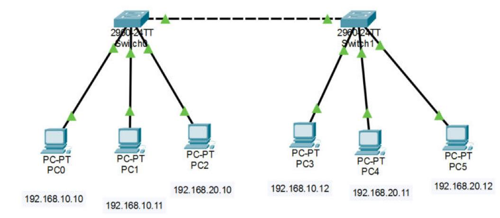
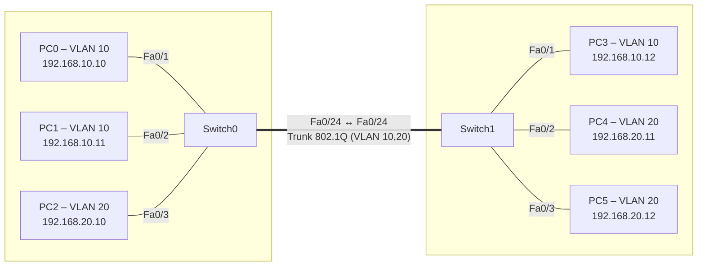

# VLAN répartis sur deux switchs avec trunk 802.1Q – Contrôle réseaux (partie C)

Contrôle de réseaux réalisé à l'ESAIP (IR3), partie C : deux VLAN (Étudiants / Enseignants) répartis sur deux switchs Cisco 2960, reliés par un lien trunk 802.1Q qui ne laisse passer que les VLAN autorisés.


## Topologie

### Capture Packet Tracer



### Schéma logique



## VLAN et adressage

| VLAN | Nom | Réseau | Postes |
|---|---|---|---|
| 10 | Etudiants | 192.168.10.0 /24 | PC0, PC1 (Switch0) · PC3 (Switch1) |
| 20 | Enseignants | 192.168.20.0 /24 | PC2 (Switch0) · PC4, PC5 (Switch1) |

## Configuration type

```cisco
vlan 10
 name Etudiants
vlan 20
 name Enseignants
!
interface FastEthernet0/24
 switchport mode trunk
 switchport trunk allowed vlan 10,20
```

Toutes les configurations sont regroupées dans [`CONFIGURATIONS.md`](CONFIGURATIONS.md).

## Compétences mises en œuvre

- VLAN étendus sur plusieurs switchs
- Trunk 802.1Q et filtrage des VLAN autorisés (`allowed vlan`)
- Vérification : `show interfaces trunk`, `show vlan brief`, `ping` entre postes d'un même VLAN sur des switchs différents

## Utilisation

Ouvrir [`controle-vlan-partie-c.pkt`](controle-vlan-partie-c.pkt) avec **Cisco Packet Tracer 8.2** ou plus récent.

## Voir aussi

- [Partie A – Segmentation VLAN sur un seul switch](https://github.com/Anatole-1/packet-tracer-vlan-single-switch)

## Contenu du dossier

| Élément | Description |
|---|---|
| [`controle-vlan-partie-c.pkt`](controle-vlan-partie-c.pkt) | Fichier Cisco Packet Tracer du projet |
| [`CONFIGURATIONS.md`](CONFIGURATIONS.md) | Configuration de chaque équipement et adressage des postes, en un seul fichier |
| [`configs/`](configs/) | Une configuration brute par équipement (`.txt`) |
| [`images/`](images/) | Captures de la topologie |

## Auteur

**Anatole BERNARD** – étudiant ingénieur à l'ESAIP
